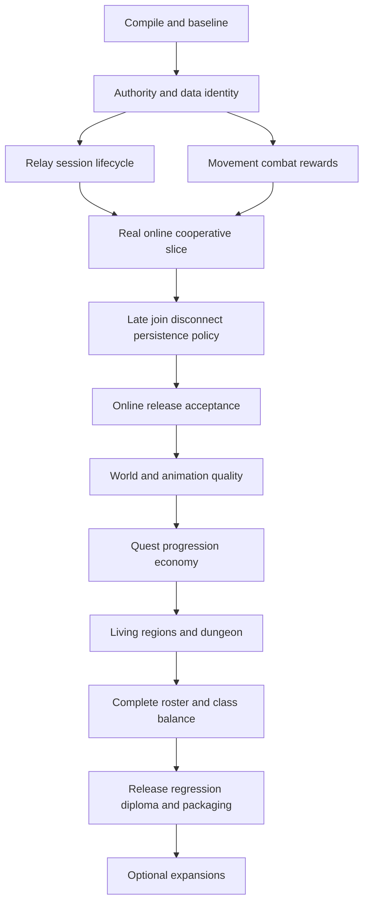

# Riftbound — complete game master plan

Revision 1 · 2026-11-15 · Planning document, not a completion report.

> Expanded production backlog: **Docs/RIFTBOUND_FEATURE_BACKLOG.md** adds detailed feature tickets, region briefs, campaign/encounter manifests, release gates and future systems. This master document retains architecture and overall design; the online work order remains the immediate implementation priority.

> Next bounded development shift: **Docs/OVERNIGHT_8_HOUR_PLAN.md**, with separate Codex/Antigravity ownership, eight elapsed-hour work packets and release gates. Copyable start/continuation prompts: **Docs/OVERNIGHT_PROMPTS.md**. These files do not start or schedule a run by themselves.

> **2026-11-16 production update:** Read **Docs/POST_ONLINE_EXPANSION_PLAN.md** for the inspected overnight baseline, GP00–GP15 gameplay queue, CW00–CW15 world queue, expanded regional/system deliveries and ownership contracts. Antigravity's handoff reports broad automated online verification; manual GUI adventure and two-PC cross-network acceptance remain NOT RUN. Do not restart online foundation work or redo the applied Reaver repair because older snapshots below describe them as pending.

> **Current integration ordering, 2026-11-16:** The user authorized combining Codexfc35bc8 and Gemini3935340 in the third checkout on **integration/combined-20261116** (merge56df479). **Docs/Integration/POST_INTEGRATION_PLAN.md** orders80 production packets; **Docs/Integration/INTEGRATION_HANDOFF.md** owns final compiler/test/build identity and release results. Initial combined01 compiled0 C# errors/built0 errors with844 warnings and recorded145 quest/41 gameplay/36 geometry/4 departure-input checks plus10/10 automated Relay scenarios. Native title/selection labels were readable, but a later check exposed an uncovered multi-tile spawn defect. The focused WorldRegions.TerrainAt spawn correction passed a new independent TerrainCollider regression32/32 (baseline19 passed/13 failed). Combined02 rebuild/final verification is underway at this update; do not substitute candidate01 results for its changed binary. The historical §3 snapshot below remains historical; its77-pass Reaver failure and two-process-only online snapshot are superseded. Full ordinary-input/animation/boss/audio/tree/camera and actual two-PC acceptance still need evidence. Do not repeat delivered foundations or treat the larger roadmap as shipped content.

## 1. Purpose, authority and how to use this plan

Build an original, stylized fantasy RPG with two factions, distinct playable races/classes, an authored world and private online cooperative play. Keep the scope approachable in its first release while mapping the larger game's full development path.

This master plan is the complete design and delivery backlog. **The immediate implementation priority remains internet co-op:** execute ANTIGRAVITY_ONLINE_MULTIPLAYER_WORK_ORDER.md O-00 through O-05, then the milestones here. The retry limits in section 6 apply everywhere. Do not treat the number of planned systems as permission to add them simultaneously.

Read current source and IMPLEMENTATION_STATUS.md first. That status file owns observed implementation/test results; this document owns intended behavior and dependencies. Historical TASKS.md exclusions and LAN-first instructions do not override the user's newer online-multiplayer request. If old documents disagree, use this plan's scope and the online work order's specific connection tasks; record unresolved design decisions rather than silently rewriting player data.

Every subsystem must have four explicit states in the status note: **not started / implemented / verified / blocked**. A source file's existence is not a functioning feature. A narrow smoke check is not full acceptance. No unchecked item in this file represents a promise that it is already implemented.

## 2. Product vision and player experience

### Design pillars

1. **Adventure with friends:** a friend can join by code, understand their role and participate meaningfully without fighting the UI.
2. **A believable frontier:** settlements have purposes, roads connect actual places, terrain supports traversal and NPCs appear occupied.
3. **Readable, responsive combat:** feet, facing, hit timing, effects and damage agree. Every dangerous action has readable counterplay.
4. **Meaningful identities:** faction, race, class, equipment and progression influence play without requiring dozens of unfinished systems.
5. **A refined presentation:** cohesive assets, restrained HUD, useful audio and reliable menus make the prototype feel intentional.
6. **Reliable progress:** rewards are earned once under defined rules; characters do not leak data or lose saves during normal use.

### Player loops

| Timescale | Player activity | Required systems |
| --- | --- | --- |
| Seconds | Move, target, use ability, respond to enemy, receive feedback. | Input, camera, animation, combat, AI, audio/VFX. |
| Minutes | Accept objective, travel, fight/interact, collect reward. | Quest/dialogue, world layout, encounters, inventory. |
| Session | Explore a region, improve gear, finish a story or dungeon with friends. | Progression, travel, group ownership, persistence policy. |
| Multiple sessions | Build a character identity, unlock regions/mounts and revisit content. | Durable character data, content unlocks, balanced economy. |

The first complete adventure should take roughly 20–30 minutes for a new player, with optional exploration extending it. Measure real playthroughs rather than padding distance or HP to meet this target.

## 3. Current baseline and scope decisions

Snapshot from inspected files and the latest status note; reverify before implementation:

- Unity 6000.6.2f1, URP, Input System, NGO 2.14.0, Multiplayer Services SDK 2.4.1 listed in manifest.
- Main authored scene: Assets/RPG/Scenes/Outpost-Expanded.unity. Four terrain tiles document a 768 × 768 m world.
- Existing scripts cover many RPG systems, including quests, classes, inventory, professions, companions, dungeons, guilds, auctions and PvP. Their presence does not establish completeness or multiplayer correctness.
- Latest status reports a two-process Relay smoke check with client damage. Separate-network acceptance, four-player/full-session QA and a normal-input complete adventure remain pending.
- Offline regression historically stops after 77 PASS lines at the Reaver terrain-asset check. Preserve the evidence; resolve the underlying scene expectation safely.
- Multiplayer progression is currently described as session-only. Persistent online characters are a separate deliverable, not implied by online joining.
- The original request was two factions, two races per faction and five classes. Current descriptions/prefabs include more races and four main class descriptions. Do not delete extra races or invent compatibility by renaming enum values.

### Decisions register

| ID | Proposed working decision | Required action |
| --- | --- | --- |
| D01 | Private 2–4 player host-authoritative online co-op. | Keep this release target; persistent MMO servers are a future architecture. |
| D02 | Sessions + Relay join codes; no normal IP field. | Complete online work order; keep offline independent. |
| D03 | Two original faction identities. | Use current faction IDs as compatibility keys; propose original display names/lore separately. |
| D04 | Core four-race launch roster; preserve additional prototypes. | Inventory existing visuals and saved IDs, propose two coherent races per faction, obtain a roster decision before restricting characters. |
| D05 | Stabilize Warrior, Mage, Rogue and Paladin first. | Audit actual abilities; add proposed fifth class Ranger after core class/network validation. Final name/role remains an explicit design choice. |
| D06 | Current level cap retained for the first polished adventure. | Raise it only with XP, gear, enemy and quest rebalance as one reviewed change. |
| D07 | Cross-faction friendly co-op; no release PvP. | Separate later PvP rules from NPC hostility and party permissions. |
| D08 | Host exit ends the session. | Tell players clearly; no claim of host migration. |
| D09 | Session-only online progression initially disclosed. | Define durable online persistence before marketing saved online characters. |
| D10 | Free, licensed assets; original WoW-inspired presentation. | Record provenance; no ripped game assets or paid asset/service purchase without approval. |
| D11 | Windows desktop is the first supported build. | Test that platform fully before promising others. |
| D12 | Existing character models retained until a consistent replacement family is reviewed. | Art pipeline may improve rigs/animation now; do not swap the whole roster impulsively. |

Resolve optional creative decisions with a documented proposal while continuing independent work. Ask only when a choice blocks safe implementation or changes promised scope, data compatibility or costs.

## 4. Release layers: broad vision, concrete delivery

| Layer | Outcome | Exit gate |
| --- | --- | --- |
| R0 — recovery | Project compiles; current defects reproducible. | Baseline report, no startup blockers, preserved saves. |
| R1 — online cooperative slice | Friends join by code and finish a real quest encounter together. | O-00–O-05 pass, including cross-network test or explicitly pending external acceptance. |
| R2 — polished adventure | Stable starter-to-frontier route, refined animations/UI, living world. | New-player full run plus offline/online regression. |
| R3 — complete compact RPG | Final launch roster, differentiated regions, progression, professions, one finished dungeon. | Content matrix and all advertised systems verified. |
| R4 — expanded game | Subclasses, more dungeons, reputation, cosmetics and controlled social features. | Each expansion respects authority, economy and save compatibility. |
| R5 — optional platform growth | Dedicated servers, PvP, public communities, larger world. | Separate feasibility, operating-cost and security design; not an incremental checkbox. |

There is no artificial limit on the long-term backlog. There is a strict limit on concurrent unfinished systems: one core implementation gate at a time, with only independent work during a documented blocker. Do not claim the entire roadmap fits the original competition month.

## 5. Dependency graph and development order



Before changing a shared contract, list affected consumers: local input, host simulation, remote presentation, UI, save data, content definitions and tests. Implement one vertical slice through these consumers before broad migration.

## 6. Execution rules and loop prevention

- Preserve uncommitted work and serialized GUIDs. Do not reset/pull over local changes, replace scenes/prefabs or run whole-world generation without the required approval. Make additive, targeted changes.
- Never scan Library, Temp, Logs or generated build folders. Use relevant source, concise console diagnostics and explicitly named validation receipts. Do not dump entire logs.
- Before a test: record ticket, hypothesis, expected observable result, timeout and attempt count. Track the last reached stage.
- At most **two unchanged failed attempts**. A new attempt requires new evidence or a material fix linked to a cause. Restarting Unity, renaming a test, reinstalling the same package or extending a timeout is not a new hypothesis.
- Stop a focused test after **10 minutes without new evidence**. Cap an unchanged blocker investigation at **20 minutes**; document the blocker and move to independent work. Counts persist across handoffs.
- Choose bounded timeouts appropriate to the operation; poll without blocking communication for long intervals. A build/import showing real progress is different from a silent connection loop.
- Stop only processes launched for the attempt, using recorded process IDs. Do not kill the user's editor or unrelated processes to resolve a lock.
- On a blocker, report expected/actual result, attempts, relevant error, next smallest diagnostic and exact user action if needed. Never mark a failed gate complete or bypass it silently.
- Compile after code edits; test consequential logic and actual player behavior. Do not write trivial tests that merely mirror implementation.
- No secrets in source, no external messages, no paid usage/account changes without authorization. Prepare reviewable local work before asking for a truly required final action.
- Record changes after each work packet. Keep files small and cohesive; avoid a universal rewrite or many speculative abstractions.

### Ticket template

```text
ID / title / priority / release:
Problem and desired player behavior:
Dependencies and actual files to inspect:
Smallest implementation:
Offline / host / client / late-join consequences:
Save/schema and asset-reference consequences:
Verification and timeout:
Observed result / evidence / attempts:
Status / limitation / next action:
```

## 7. Architecture and content contracts

### ARCH-01 — responsibility boundaries [R1]

- [ ] Map current PlayerController partials, UI singletons, static state, network avatars and world managers. Identify who creates/destroys each object on scene/session changes.
- [ ] Keep local player input/camera/UI separate from host simulation and remote model presentation. No global first-player lookup in multiplayer gameplay decisions.
- [ ] Use one session bootstrap, one NetworkManager and one shutdown path. Ensure menu entry works without smoke-test CLI shortcuts.
- [ ] Reuse existing services; introduce interfaces only where they separate a real offline/online or test boundary.
- [ ] Avoid hardcoded display names for identity and repeated per-frame scene searches. Use registered entities and explicit references where appropriate.

Acceptance: entering/leaving/re-entering offline and online sessions does not duplicate actors, listeners, callbacks or state.

### ARCH-02 — data definitions and stable identifiers [R1–R3]

| Definition | Minimum fields |
| --- | --- |
| Character | Character ID, schema, faction/race/class IDs, appearance, progression, equipment. |
| Ability | Stable ID, allowed class, targeting, cost, cooldown, cast/recovery, effect, audio/VFX references. |
| Item | Stable ID, category, stack size, rarity, stats, restrictions, value, icon/model, source. |
| Quest | Stable ID, prerequisites, objective IDs/types, giver/turn-in, rewards, repeat rules, text keys. |
| Enemy/encounter | Stable spawn ID, archetype, stats, abilities, home/leash, loot, respawn policy. |
| Zone | Stable ID, bounds, entrances, roads, biome, difficulty, audio/weather, content budget. |
| Event | Stable ID, trigger, stages, participants, success/failure, cooldown, claim policy. |
| Loot transaction | Session/player identity, operation ID, source, validated grant and claim result. |

- [ ] Extend existing ScriptableObjects/catalogs rather than duplicating them. Migrate only where hardcoded content causes real defects.
- [ ] Validate duplicate/missing IDs, invalid references, circular quest prerequisites and unknown reward items before release.
- [ ] Separate immutable definitions from per-session/per-character state. Never mutate shared asset definitions to store one player's quest progress.
- [ ] Map legacy IDs explicitly; preserve numeric enum compatibility and serialized references during refactors.

## 8. Internet multiplayer, ownership and authority

The online work order is the detailed implementation checklist. These contracts apply to every new system.

| System | Authority | Replicated/persistent behavior |
| --- | --- | --- |
| Input, settings, camera, HUD | Local owner | No remote player can create or operate local controls. |
| Movement | Host validation; bounded owner prediction if needed | Interpolated remote pose, explicit authorized teleports, collision consistency. |
| Combat, resources, cooldowns | Host | Accepted action results and durable health/status; client requests are untrusted. |
| Enemy AI, schedules, events | Host | Actors, position/action state, event phase and late-join state. |
| Inventory, rewards, shops | Host validated transactions | Per-player ownership and idempotent grant/claim results. |
| Quests and discoveries | Host validates relevant events | Individual progression; shared credit only under defined eligibility. |
| Cosmetic effects/audio | Presentation from accepted actions | No historical transient-effect replay on join; prevent duplicates. |
| Saves | Explicit mode-specific policy | Offline files protected; online identity/persistence requirements documented. |

### NET-01 — connectivity and admission [R1]

- [ ] Complete UGS initialization, anonymous profiles, private Sessions/Relay create/join, code copy, cancellation and error recovery.
- [ ] Enforce capacity and build/protocol/content compatibility. Reject invalid admission clearly; never trust display name as identity.
- [ ] Avoid double StartHost/StartClient when SDK sessions own networking. Clean up sessions created after a cancelled async attempt.
- [ ] Verify actual cross-network connectivity; same-machine Relay smoke is intermediate evidence.

### NET-02 — action validation and consistency [R1]

- [ ] Host derives damage/cost/cooldown from known definitions, validates ownership, state, range, LOS and target rules. Clients never dictate arbitrary HP, level, gold or damage.
- [ ] Define request IDs, stale-request handling, rate limits and exactly-once reward behavior. Do not send RPCs for unchanged data every frame.
- [ ] Separate durable replicated state from cosmetic action events. Snapshot world state at a defined readiness point for late joiners.
- [ ] Audit targeted RPCs on the intended network object and recipient. Test client health loss, kill credit, quest rewards and chest approval individually.
- [ ] Set movement update/interpolation policy from measured latency. Check stairs, slopes, collisions, knockback, dodges, mounts and portal teleports.

### NET-03 — failure, lifecycle and scale [R1]

- [ ] Handle joining during combat/events, late loading, client drop, host departure and reconnect attempts. Do not promise seamless reconnect until state restoration is tested.
- [ ] Clear static registries, UI locks, event handlers and pending operations on leave. Repeat host/join/leave without restarting the application.
- [ ] Test four simultaneous players and fifth-player refusal, latency/loss, slow loading and mismatched builds.
- [ ] Track bandwidth and active network entities. Introduce relevance/zone filtering after correctness, based on measured load.
- [ ] Explicitly document trusted-host limits. Relay/anonymous authentication does not make a modified host trustworthy or create a global persistent economy.

## 9. Character creation, factions and roster

### CHAR-01 — creation and selection [R2]

- [ ] Inventory currently working race/class visuals and legacy Brute/Human/Undead enum/string aliases. Separate technical IDs from displayed names.
- [ ] Character flow: faction → race → class → appearance/name → preview → create → select mode → enter. Permit easy Back without losing valid choices.
- [ ] Validate names for length, unsupported formatting/control characters and text rendering. Names do not need to be globally unique for private co-op.
- [ ] Preview shows correct feet height, facing, lighting and equipment against a cozy faction scene. Support missing-model fallback with a visible diagnostic in development.
- [ ] Character deletion requires explicit confirmation and targets only that slot; preserve backups and never auto-delete incompatible saves.
- [ ] Show class role, resources and a short ability preview. Avoid misleading locked class/race choices.

### CHAR-02 — faction and race identity [R3]

- [ ] Author original faction motivations, colors, symbols and starting quest hooks. Keep each faction internally coherent rather than a collection of copied references.
- [ ] Core races each need one visual identity, starter dialogue variant and bounded passive. Keep bonuses small enough that class choice matters more.
- [ ] Review current racial bonuses against movement, gold inflation, lifesteal and multiplayer validation. Apply bonuses once at the correct authority boundary.
- [ ] Preserve shared-world co-op even across factions; hostile NPC access rules need explicit safe interactions and quest alternatives.
- [ ] Keep additional prototype races available in a clearly designated backlog or review area; do not silently remove existing characters.

Acceptance: every supported race/class combination can create, preview, spawn, equip, fight, mount, die and reload without wrong orientation or missing visuals.

## 10. Classes, abilities and build progression

### CLASS-01 — existing four-class quality pass [R2]

| Class | Play identity | Core quality requirements |
| --- | --- | --- |
| Warrior | Durable close-range pressure | Reliable strike, readable cleave, useful recovery/guard; no mandatory healer dependency. |
| Mage | Ranged damage and control | Projectile LOS, bounded crowd control, clear ward/blink rules and server-approved teleport. |
| Rogue | Mobile burst and positioning | Fast readable attacks, meaningful finisher setup, sprint consistency; no animation-speed exploits. |
| Paladin | Durable support and area control | Distinct holy strikes, bounded ground effects, properly targeted heal with validated cost/cooldown. |

- [ ] Audit implementation against descriptions/tooltips, including hidden/basic attacks and resource regeneration.
- [ ] Define targeting rules: enemy/friendly/self/ground, range, LOS, facing, dead targets, movement during cast, interruption and recovery.
- [ ] Create a shared ability-resolution path for host and remote actions. Preserve responsiveness with predicted presentation only when rejection/correction is handled.
- [ ] Balance solo survivability and cooperative contribution. Test mixed and duplicate-class parties; don't require the perfect tank/healer composition.
- [ ] Ensure talent/glyph/equipment modifiers apply once and reset between characters. Detect circular or multiplicative modifier errors.

### CLASS-02 — fifth class and subclasses [R3/R4]

- [ ] Proposed fifth class Ranger: basic shot, interruptible charged shot, and trap/utility. Requires compatible bow/equipment animation and projectile behavior before being selectable.
- [ ] Prototype the full fifth-class loop in a bounded encounter, including remote visuals, itemization, UI/icons and saves. Do not ship an extra button that reuses another class's damage without identity.
- [ ] After base classes are stable, design two specializations per class as focused modifier sets. Avoid multiplying unique animation and networking systems.
- [ ] Add respec policy, cost, combat restrictions and reversible point allocation. Schema migrations must preserve spent points or refund them deterministically.

Acceptance: each launch class has a complete small kit and a clear strength/weakness; no unused class selection leads to placeholder combat.

## 11. Movement, camera, animation and physical interaction

### MOVE-01 — movement and controls [R1/R2]

- [ ] Normal travel is running with a slow-walk toggle; expose clear keybinds. Resolve conflicts among dodge, mount cycle, target, interaction and menu keys.
- [ ] Define acceleration/deceleration, backpedal/strafe speeds, air control, jump rules, slope/step limits and movement while casting/guarding.
- [ ] Prevent UI clicks from attacking through menus; handle focus loss, pause, chat text input and cursor locking correctly.
- [ ] Use the actual controller to test bridges, stairs, switchbacks, building doors, water edges and dungeon exits.
- [ ] Provide a safe unstuck action with cooldown and restrictions; host validates online relocation.

### ANIM-01 — import and locomotion quality [R2]

- [ ] Record each model's source axis, scale, avatar/rig, visual-root orientation and animation compatibility. Preserve original imports; use controlled variants.
- [ ] Fix root drift and retargeting before procedural corrections. Do not rotate controller physics to compensate for a backward mesh.
- [ ] Verify loop settings and transitions for run/walk/backward/strafe/idle; align playback and controller speed to stride distance.
- [ ] Check foot orientation and grounding across the animation cycle and slopes. Foot IK, if used, has limited offsets and is disabled for unsuitable states.
- [ ] Handle attack/cast/hit/death/jump/mount priorities; prevent repeated crossfades every frame and one-shot actions that never return to locomotion.
- [ ] Remote animation follows accepted action and locomotion state; provide safe fallbacks for missing clips without hiding the problem in development.

### CAMERA-01 — reliable third-person framing [R2]

- [ ] Collision-aware orbit/zoom, stable following, useful default distance and mounted framing.
- [ ] Test steep slopes, interiors, narrow doors, walls, roofs and characters at different scales. Camera collision must not expose under-terrain views.
- [ ] Offer sensitivity, invert Y and shake strength/off. Camera shake must not stack indefinitely.

Acceptance: prolonged normal play shows no repeated foot flip, floating/sideways root movement, stuck pose or camera loss; verify actual motion rather than only curve statistics.

## 12. Combat rules, enemies and encounters

### COMBAT-01 — authoritative combat contract [R1]

- [ ] Define health, resources, armor/resistance, crit, shields, healing, invulnerability and status stacking in one order of operations.
- [ ] Prevent post-death damage, pending hits after evade, stale projectiles, through-wall melee and duplicate death callbacks.
- [ ] Establish friendly targeting, party healing, threat and aggro rules. Host owns enemy targets across all connected players.
- [ ] Telegraph dangerous areas honestly, including damage timing, terrain projection and interrupt windows.
- [ ] Add minimal damage/heal feedback with configurable numbers. Effects communicate impact without hiding attacks.

### AI-01 — distinct reusable archetypes [R2/R3]

| Role | Behavior | Counterplay |
| --- | --- | --- |
| Melee raider | Pursue, wind up, strike, recover. | Spacing, guard/dodge, interrupt where supported. |
| Ranged attacker | Maintain bounded distance, shoot with LOS. | Cover, closing distance, readable projectile. |
| Caster | Cast a dangerous spell and reposition. | Interrupt, LOS, avoid marked area. |
| Defender | Protect an area/ally with slower heavy attacks. | Flank or bait recovery; no permanent invulnerability. |
| Skirmisher/beast | Short approach/burst, retreat or pounce. | Anticipate windup and respond. |
| Elite/captain | Combines two proven patterns plus one modifier. | Clear tell and reward appropriate to effort. |

- [ ] Reuse shared state transitions: idle/patrol/alert/chase/windup/attack/recover/evade/dead.
- [ ] Bound navigation retries and path failures; return to a validated home position if stuck. Preserve leash/LOS/reset fixes.
- [ ] Stagger attacks/positions so groups do not collapse into one point. Avoid unreadable simultaneous unavoidable hits.
- [ ] Affixes must have clear effects, caps and valid interactions with death/cleanup. Do not add more before existing Molten/Vampiric/Frostbound/Arcane behavior is verified.
- [ ] Specify spawn/respawn and loot eligibility; enemy identity must distinguish a respawned life from an already-claimed defeat where needed.

### BOSS-01 — bosses with learnable mechanics [R3]

- [ ] Use two-phase fights built from existing validated mechanics: ground warning, interruptible cast, add wave, movement choice.
- [ ] Define encounter start, arena bounds, participants, wipe, reset, late join and reward lockout.
- [ ] Scale health/add population within bounded 1–4 player rules; changing party membership must not repeatedly heal/reset rewards.
- [ ] Test solo, duplicate classes, low-level gear and an interrupted connection. No progression requires an unavailable role.

## 13. World map and region-by-region production

### WORLD-01 — preserve the authored map and fix foundations [R2]

- [ ] Verify documented four-tile coverage and bounds x[-320,448], z[-160,608] against current scene. Keep authored roads/platforms and underground interior separation.
- [ ] Audit tree prototypes/mesh axes, upright prefabs, intentional logs, root scales and terrain instances. Verify actual rendering after the recorded mesh-bake repair.
- [ ] Repair floating/buried props, reversed visuals, missing materials, light-helper meshes and road blockers with per-instance evidence.
- [ ] Smooth abrupt shelves, slopes and terrain texture transitions narrowly. Test tile seams, camera clearance, NavMesh and mount traversal after edits.
- [ ] Define true world borders through terrain/scenery and safe collision. Future expansion changes terrain bounds and route length, not merely prop density.

### WORLD-02 — region production matrix [R2/R3]

All additions below are proposed content; audit existing content before implementing them.

| Region | Existing reference | Desired identity and content | Acceptance route |
| --- | --- | --- | --- |
| Emberwatch / Ashwood | (0,0..100) | Starter outpost, Abe chain, training area, forge, supply loading and safe departure. | Spawn → giver → raiders → supplies → captain → return. |
| Highspire Keep | (-200,-60) | Faction hub, practical market/work areas, west-road junction, limited services. | Enter gate → service → road junction without collision traps. |
| Frostpeak foothills | (-95,-90) | Cold foothill outpost, quarry/workers, rocky trails and an optional discovery. | Safe path connects starter area to main faction route. |
| Silverglen Sanctum | (-150,75) | Quiet magical grove, distinct ecology, original ritual/story hook. | Grove approach, encounter and return readable by landmarks. |
| Westbank / Willow Rest | (-285,50..60) | River crossing, roadside inn/rest, caravan, reeds and Reaver threat. | Bridge and graded camp trail on foot and mount. |
| Deathknell Hollow | (-240,180) | Shadowed settlement with active residents and recovery/ruin story. | Safe arrival, services and clear connection to cathedral road. |
| Duskwood Cathedral | (-220,260) | Ruined exterior, foreshadowing, encounter staging and dungeon portal. | Road → entrance → interior → correct return point. |
| Rustwater Scrapworks | (240,150) | Industrial/scrap hub, gathering/crafting purpose and controlled ambient effects. | Main pass stays clear of clutter, smoke and work props. |
| Bloodrock | (280,210) | Fortified camp, patrols, training and eastern quest hub. | Entrances and service paths support a four-player group. |
| Gor'Kresh | (340,290) | Distinct faction stronghold, social/service space, believable circulation. | Camp-to-stronghold road and hub readable without UI spam. |
| Gorgonax crater | (180,300) | Open optional boss arena with safe approach and retreat route. | Warning, entry, encounter/wipe and exit all clear. |
| Greenhollow / Ancient Grove | (-40,400)/(5,445) | Forest hamlet, farms, cartographer, wildlife and exploration rewards. | Three landmarks plus return; preserve existing mount gates. |
| Wyrmcrest Summit | (250,510), ~75m | Long mountain approach, switchbacks, lookout and apex encounter. | Continuous climb/descent without mandatory terrain exploits. |

### WORLD-03 — new land expansion pipeline [R3/R4]

- [ ] First identify an actual content/travel need and new bounds; draw route entrances and sightlines before generating terrain.
- [ ] Add a connected region with a different silhouette/biome/encounter role. Preserve old tile GUIDs, saved coordinates and border logic.
- [ ] Author topology, roads/bridges, water and navigation before placing detailed props or encounters.
- [ ] Add hub, two travel routes where sensible, one optional site and a complete quest/encounter loop. Density follows purpose and ecology.
- [ ] Update world map bounds, coordinates, fast travel, scene loading, performance budgets and multiplayer relevance.
- [ ] Validate full outbound/return journeys and old-save spawn recovery. Never call an area expanded just because more objects fit inside existing bounds.

### WORLD-04 — ecology and environmental storytelling [R2/R3]

- [ ] Cluster vegetation by water, exposure, terrain and land use; transition biomes gradually. Preserve roads, encounter sightlines and useful empty space.
- [ ] Settlements need food/water, storage, work, rest and access. Use repairs, cart tracks, supplies and abandoned sites to imply activity.
- [ ] Water needs credible banks/flow, bridge supports and a defined collision/swimming policy. Do not imply deep water is traversable without mechanics.
- [ ] Use lighting/weather/ambience to reinforce a region, not to conceal missing worldbuilding. Keep night and fog playable.

## 14. Living world, schedules and dynamic events

### LIFE-01 — believable activity [R2]

- [ ] Audit Wildlife, RoadPatrolGuard, TownNPC, WeatherSystem and ZoneAudioAmbience; extend the existing systems.
- [ ] Define activity points, routes, waits, work actions and bounded schedules for workers, guards, vendors and travellers.
- [ ] Quest-critical NPCs remain accessible and cannot wander into permanent danger. Interactions pause/resume routines predictably.
- [ ] Wildlife grazes/wanders/flees with host-owned decisions and distance budgets; avoid a full ecosystem simulation before basic behavior works.
- [ ] Handle stuck paths, absent destinations and player blocking. Despawn/cull presentation without losing authoritative quest/event state.

### EVENT-01 — reusable event state machine [R1/R2]

Stages: available → triggered → active objectives → success/failure → reward resolution → cleanup → cooldown. Include eligibility, failure timeout, participants, persistent IDs and host ownership.

| Event | Initial version | Failure/cleanup requirement |
| --- | --- | --- |
| Supply caravan | Real wagon/escort visuals, raider ambush and arrival. | Destroyed wagon, abandoned escort, disconnect and stuck-route recovery. |
| Roadside rescue | Defeat attackers and interact with surviving scout. | Scout defeat/timeout, leave area, no false success if everyone leaves. |
| Settlement defense | Small bounded wave at an existing camp. | Protect critical NPCs, cancel safely, clean leftover enemies. |
| Lost traveller | Find trail clues and lead traveller to a safe point. | Route failure/rejoin, no permanent quest blocker. |
| Ruin disturbance | Optional interactable triggers a contained encounter. | Once-per-eligible-player reward; no recursive spawn exploit. |

- [ ] Finish the first two before adding others. Distinguish full first-clear reward, repeat bounty and cooldown; persist first-clear claims only if persistence is supported.
- [ ] Replicate active event actors/state and target rewards to each eligible participant. Late join must neither duplicate event actors nor replay payouts.
- [ ] Provide bounded development triggers and deterministic seeds where useful. Keep them out of player HUD/release controls.

## 15. Narrative, dialogue and quest design

### STORY-01 — original narrative framework [R2/R3]

- [ ] Write a one-page premise, faction motivations, regional threats, named NPC roles and naming rules. Original writing/art should carry the game's identity.
- [ ] Build the first arc around supply disruption, securing the road, mapping the frontier and uncovering a larger ruin threat.
- [ ] Give each zone a local problem, progression beats, optional discovery and connection to the next region. Avoid every quest being an unexplained kill counter.
- [ ] Keep dialogue concise, skippable and state-aware. Full voice acting is optional; text must work independently.

### QUEST-01 — quest framework and UI [R1/R2]

- [ ] Support kill, collect, interact, discover, escort and boss objectives through reusable definitions. Add objective types only when content needs them.
- [ ] Define prerequisite, acceptance, active, ready-to-turn-in, complete, abandoned and repeatable states. Handle prior discoveries deliberately.
- [ ] Show objective counts, location hint, reward preview and return target. Journal tracks one primary objective without a crowded HUD.
- [ ] Shared kills use eligibility/distance rules; players accept/turn in independently. Collectibles/chests cannot be consumed permanently by another player.
- [ ] Abandon/reaccept must not duplicate currency, restore spent quest items accidentally or reset completed claims.
- [ ] State-aware NPC dialogue and quest indicators must match host-approved progress, including reconnect/save restoration.

### QUEST-02 — launch content inventory [R2/R3]

- [ ] Preserve and validate Abe's three missions, cartography/Elara, Reaver captain bounty, exploration markers, runestones and regional boss objectives.
- [ ] Add one introductory chain per launch faction using distinct starting locations, converging on shared frontier content.
- [ ] Add optional side objectives that reward exploration, professions and environmental stories without blocking the main route.
- [ ] Produce a quest table with IDs, prerequisites, objective source IDs, giver/turn-in location, level, reward and offline/online test status.

Acceptance: a fresh character can finish the core arc without debug actions; old completions survive; reward retries and out-of-order kills do not bypass gates.

## 16. Progression, equipment, loot and economy

### PROG-01 — XP and character growth [R2/R3]

- [ ] Audit XP thresholds, level cap, racial bonuses, rested XP, talent points and reward stacking. A modifier is applied once.
- [ ] Build a spreadsheet/table of expected level/gear across the adventure and check real runs for stalls or overleveling.
- [ ] Do not expand levels without enough meaningful abilities, encounters and items. Keep level-up feedback brief and skippable.

### ITEM-01 — equipment and inventory [R1/R2]

- [ ] Complete stable item definitions, stacks, equipment slots, restrictions, rarity, icons, tooltip comparison and equip/unequip feedback.
- [ ] Test full inventory, split/merge, unique items, item removal while equipped, invalid references and cross-character switching.
- [ ] Add small coherent equipment families: basic starter, road-earned upgrades, crafted alternatives and boss reward. Every item has a source and useful tradeoff.
- [ ] Cosmetic appearance and stats remain separate where existing transmog permits; do not allow cosmetics to bypass restrictions.

### LOOT-01 — loot entitlement and transactions [R1]

- [ ] Define per-player enemy/chest reward policy, repeat-event rewards, respawn-life identity and party roll behavior.
- [ ] Prevent duplicate grants, consume-on-failed-grant and reconnect claim resets. Use a host transaction result with stable operation identity.
- [ ] Preserve unclaimed/partially claimed loot under the promised persistence policy. Online session-only must be explicit.
- [ ] Gear rewards respect supported classes; useless drops have a vendor/material purpose rather than bloating inventory.

### ECON-01 — vendors, costs and sinks [R2/R3]

- [ ] Audit gold sources and sinks: kills, quests, events, vendor values, potions, travel, crafting/respec where appropriate.
- [ ] Host validates buying/selling/crafting atomically; insufficient space/funds or duplicated input must leave state consistent.
- [ ] Tune repeatable bounties against travel/encounter effort so they do not trivialize the main arc. Avoid arbitrary grind or repair taxes in the short demo.
- [ ] Shops need clear buy/sell feedback, stock rules, item restrictions and reasonable interaction distance.
- [ ] Auctions/trading/global markets remain unavailable until durable trusted inventory and transaction semantics exist; local simulated systems must be labeled honestly.

## 17. Professions, gathering and exploration activities

### CRAFT-01 — one complete gathering/crafting loop [R3]

- [ ] Inventory profession/fishing/gathering code. Select one gathering type and one production type to polish first.
- [ ] Define node ecology, respawn, tool/skill requirements, interrupt rules and per-player/shared ownership.
- [ ] Provide a few useful recipes with explicit materials, output quantity, progression and failure behavior. Validate atomically on host.
- [ ] Fishing/archaeology can become optional activities after the primary loop; they need actual input, reward, animation/audio and network behavior, not empty panels.

### EXPLORE-01 — discovery and collectibles [R2/R3]

- [ ] Preserve exact landmark/mount unlock conditions and separate unrelated markers.
- [ ] Tie optional discoveries to viewpoints, ruins, caches and short stories. Clues should exist in the world, not only on a minimap.
- [ ] Achievements/titles/cosmetic rewards have stable IDs and one-time claims, with restrained notifications.
- [ ] Display collected/remaining progress accurately without exposing every secret by default.

## 18. Mounts, companions, pets and travel

### TRAVEL-01 — mounts and world traversal [R1/R2]

- [ ] Verify summon time, cancellation, damage/action dismount, unlock selection, saddle/rider pose, ground clearance and camera framing.
- [ ] Replicate mount type and visible model/rider state, not merely a nameplate label. Ensure dismount positions are safe.
- [ ] Check water, doors, dungeon portals, slope/step limits and host-authorized travel. Mount speed is server validated.
- [ ] Preserve horse availability and exact zebra landmark unlock. Add later mounts as cosmetic/achievement rewards after pipeline quality is proven.
- [ ] Hearth/flight/portals require valid destination, cost/cooldown rules, cancellation and session/world readiness; never teleport into unloaded geometry.

### PARTY-01 — opt-in companions [R2/R3]

- [ ] Begin solo. Explicit menu recruits/dismisses companions and pets; no automatic army at spawn.
- [ ] Define ownership, capacity, AI authority, formation, combat contribution, recall distance and dismissal persistence.
- [ ] In a four-player party, bound companion count and VFX/AI budget. Avoid duplicate companions on clients or free reward multipliers.
- [ ] Add follow/hold/passive commands only if they have clear behavior and low UI cost.
- [ ] Pet battles remain optional R4 content and require a separate complete ruleset before appearing as a release feature.

## 19. Dungeons, group encounters and endgame

### DUNGEON-01 — finish one existing dungeon [R3]

- [ ] Improve Scarlet Crypts or another existing interior before building more. Keep separate underground geometry and correct portal return.
- [ ] Author entrance/staging, two encounter rooms, boss space, reward interaction and a reliable exit. Lighting/navigation must support the camera.
- [ ] Shared encounter state defines admission, late join, wipe, reset, doors and per-player reward entitlement.
- [ ] Validate solo and 2–4 player completion, disconnect during transition and players entering/leaving at different times.
- [ ] Group finder remains a simple party activity selector until public matchmaking is genuinely implemented; do not represent NPC companions as real online players.

### END-01 — replayability after the story [R4]

- [ ] Add optional elite hunts, timed event rotations or dungeon challenges using proven encounter systems.
- [ ] Reward cosmetics, alternative gear or mastery goals rather than unbounded stat inflation.
- [ ] Define resets, difficulty selection and reward cadence. Avoid daily obligations in a compact competition game.
- [ ] A second dungeon or new region requires the first one's content/performance test pattern and persistent-ID discipline.

## 20. Social systems and optional competitive features

### SOCIAL-01 — private cooperative essentials [R2/R3]

- [ ] Compact party frames, connection state, team map pings, optional text chat and ready checks. Hide party UI when solo.
- [ ] Rate-limit messages/pings, bound text length and escape rich text/control characters. No unsolicited external messaging or telemetry.
- [ ] Add host removal/blocking only with explicit ownership and useful client recovery. No claim of a full moderation service.
- [ ] Downed ally revive is an optional extension after ordinary respawn works; validate range, interruption, concurrent helpers and disconnect.

### SOCIAL-02 — guild/mail/trading feasibility [R4/R5]

- [ ] Audit existing GuildSystem, MailboxSystem and AuctionHouseSystem for local mock behavior. Label or hide incomplete online features.
- [ ] Real persistent guilds, mail and player trade require identity, durable storage, authorization, atomic transfer and abuse rules. Design those before implementing UI promises.
- [ ] Never store shared economy records only in editable local JSON and advertise them as secure online transactions.

### PVP-01 — separate future ruleset [R5]

- [ ] Decide explicit opt-in duel/battleground/open-world rules and party/faction exceptions.
- [ ] Separate PvP scaling, CC limits, consent, safe zones and disconnect outcomes from cooperative combat.
- [ ] Public competitive play requires a trusted-server/security and operating plan. Do not enable prototype PvP merely because scripts already exist.

## 21. Art direction and asset production pipeline

### ART-01 — coherent visual family [R2/R3]

- [ ] Produce a small visual guide: silhouettes, proportions, palette, material roughness, texture detail, architecture language and reference screenshots.
- [ ] Review current Quaternius buildings/nature/characters together. Choose compatible stylization instead of increasing polygon count on one asset independently.
- [ ] Maintain an asset register: source URL, creator, license, local path, changes, texture/triangle/material counts, rig/animation compatibility and acceptance status.
- [ ] Free downloaded models need license verification and import review. AI-generated assets need inspection, topology/material/rig cleanup and recorded origin; they are not automatically game-ready.

### ART-02 — Blender/model admission checklist [R3]

- [ ] Verify scale in metres, axis/forward direction, applied transforms, pivot, normals/tangents, UVs, material slots and texture color spaces.
- [ ] Create game-ready topology, LODs where useful, collision proxies and sensible bounds. High-poly sculpt prototypes stay outside gameplay until converted and reviewed.
- [ ] Characters need deformation tests at shoulders/hips/knees/feet, consistent skeleton/export settings, equipment sockets and compatible clips.
- [ ] Export a review asset, inspect in Unity under target lighting, then admit through a controlled prefab variant preserving existing references.
- [ ] Test one representative character fully before replacing the roster. Maintain a fallback and record before/after performance.

### ART-03 — environment kit completion [R2/R3]

- [ ] Fill purposeful gaps: wagon, bridge parts, workbench/forge props, road signs, fences, storage, ruin pieces and believable settlement clutter.
- [ ] Reuse modular proportions and material families. Collision differs from visible detail; tiny props need not each have heavy mesh colliders.
- [ ] Protect sightlines and path width; no decorative object may make a mandatory interaction unreachable.

## 22. Graphics, lighting, VFX and audio

### RENDER-01 — render quality and scalability [R2]

- [ ] Establish reference day/night scenes and low/medium/high presets appropriate to measured hardware.
- [ ] Tune URP shadows, AA, fog, ambient lighting, contact shading, color grading and bloom coherently. More effects do not equal better art.
- [ ] Diagnose visible light helpers/gizmos/meshes; hide only development geometry, not needed illumination.
- [ ] Use static/baked versus dynamic light decisions consciously. Check moving doors/actors and day-night assumptions before baking.
- [ ] Validate water transparency, particle sorting, foliage, terrain transitions and character readability in all regions.

### VFX-01 — effects with gameplay meaning [R2/R3]

- [ ] Assign each damage/school/control role a visual language; maintain readable enemy warnings distinct from friendly effects.
- [ ] Pool repeated effects where measured; cap simultaneous particles, lights and decals. Cleanup on cancel/death/scene exit.
- [ ] Replicate accepted effect events once; local prediction must reconcile with the accepted cast rather than doubling particles/audio.
- [ ] Provide reduced-flash/effect intensity options and avoid excessive camera shake.

### AUDIO-01 — complete and restrained soundscape [R2/R3]

- [ ] Use categories for master/music/ambience/SFX/UI; persist settings locally and apply them consistently.
- [ ] Add grounded footsteps, weapon/cast/hit/heal, mount, interaction, UI confirmation/error and zone ambience cues using licensed sources.
- [ ] Spatialize world sounds with sensible range/rolloff, concurrency and priority. Prevent repeated loops and multi-client duplicate playback.
- [ ] Use a small coherent music palette with transition fades; no ripped soundtrack. Dialogue remains playable without voice acting.
- [ ] Important warnings need visual equivalents; settings changes should preview volume without loud surprises.

## 23. UI, onboarding, accessibility and localization

### UI-01 — full screen/flow inventory [R1/R2]

| Flow | Required behavior |
| --- | --- |
| Title | Rotating original backgrounds, clear Play/Settings/Controls/Quit, graceful missing-art fallback. |
| Character selection | Correct preview, create/back, clear slot data and explicit delete confirmation. |
| Online session | Host/Join code, copy, progress/cancel, player count, errors and leave. |
| Gameplay HUD | HP/resource, target, abilities, contextual interaction, compact tracker and minimap. |
| Menus | Inventory/equipment, journal/map, skills/talents, companions and settings accessed intentionally. |
| Dialogue/vendor | Readable options, reward/cost preview, range/close behavior and no click-through attacks. |
| Death/loading | Clear recovery action, honest progress/error state and usable Back path. |

- [ ] Keep default HUD minimal. Optional metrics/chat/logs stay collapsed or hidden; no permanent panel for each system.
- [ ] Ability icons reuse original atlas/style; tooltip values match actual host-approved rules, including costs/cooldowns.
- [ ] Handle keyboard navigation, Escape/back stack, focus, cursor capture and input rebinding without key conflicts.
- [ ] Test 1280×720, 1920×1080, windowed/fullscreen and varied aspect ratios; document supported scaling.

### UX-01 — first ten minutes [R2]

- [ ] Teach movement/camera, interaction, target/attack, ability, loot, quest return and optional online joining through short contextual hints.
- [ ] Allow hints to be dismissed and reviewed in Controls. Do not interrupt combat with modal tutorials.
- [ ] First encounter demonstrates counterplay safely; first reward is visibly useful; the next destination is readable.
- [ ] Observe someone unfamiliar with the game. Record confusion and fix the cause rather than adding a wall of instructions.

### ACCESS-01 — accessibility and language [R2/R3]

- [ ] Readable text scale/contrast, color-independent status cues, reduced shake/flashes, separate volume controls and configurable sensitivity.
- [ ] Subtitle/text alternatives for important dialogue/warnings; avoid essential information only in ambient audio.
- [ ] Centralize player-facing strings as content is stabilized. Select one complete release language before advertising translations.
- [ ] Preserve English technical terms where requested; Bulgarian diploma/documentation can explain them without inconsistent UI spelling.
- [ ] Controller support is a separately tested expansion; do not advertise it based only on Input System availability.

## 24. Saves, identity, migrations and recovery

### SAVE-01 — offline reliability [R1/R2]

- [ ] Inventory adventure/faction/settings/talent/companion files and static state. Save data belongs to one character or explicit account/settings scope.
- [ ] Version schemas, preserve backups, write via safe staging and recover from corrupt/missing/older files without destroying originals.
- [ ] Test character A → B → A, deleted/missing slot, interrupted write and legacy coordinates. Reset transient talent/quest/party state deliberately.
- [ ] Stable definitions and migrations must handle renamed display text, retired items and new world bounds.

### SAVE-02 — durable online progression [R3/R4, separate gate]

- [ ] Choose trusted persistence owner and supported reconnect identity. Anonymous UGS identity alone does not provide cross-device recovery or cloud saving.
- [ ] Define character import policy, session checkpoints, host crashes, lost connection, duplicate claims and transaction recovery.
- [ ] Keep online and offline stores isolated unless an explicit, validated import/export process exists. No hidden overwrite of an offline hero after online play.
- [ ] Decide whether private co-op permits trusted local character exports or requires a backend. Document cheating/trust limits clearly.
- [ ] Cross-device persistent accounts/global inventories require a separate backend, privacy, security and operating-cost design before implementation.

Acceptance: promised data survives supported transitions; unsupported persistence is disclosed before a player spends a session expecting saved rewards.

## 25. Security, privacy and service operations

- [ ] Validate every client command at its authority boundary; bound payload size, rates, identifiers and numeric ranges. Treat ownership and identity separately from display text.
- [ ] No credentials/service keys in Git or builds. Store project/environment configuration deliberately; redact tokens and join codes from unnecessary diagnostics.
- [ ] Record external service requirements, quotas, billing terms and ownership in ONLINE_SETUP.md. Do not enable paid use without approval or promise unlimited free capacity.
- [ ] Session codes are invitations, not a secure persistent account system. Host-authoritative private co-op has a different threat model from public competitive servers.
- [ ] Collect only diagnostics needed for development; no automatic external analytics/personal data transmission without a defined user-facing policy.
- [ ] Public chat/community/server features require moderation/report/block and privacy review before release, not just a UI panel.
- [ ] Service outages must preserve offline access and offer useful errors instead of infinite authentication retries.

## 26. Performance, loading and technical budgets

### PERF-01 — baseline and budgets [R1/R2]

- [ ] Profile a fixed route in a standalone at fixed resolution/settings on the presentation PC and one lower-capability target if available.
- [ ] Record CPU/GPU frame time, spikes, memory, allocations, active AI, draw calls/triangles, lights/shadows, load times and bandwidth.
- [ ] Set explicit budgets from measurements; use a provisional 60 FPS target at the chosen reference settings, and record the hardware/quality assumptions. A 16.7 ms frame budget is a target, not a measured pass.
- [ ] Track worst sections: crowded hub, forest vista, four-player VFX fight, dungeon and terrain transition. Average FPS alone hides stalls.

### PERF-02 — optimize demonstrated bottlenecks [R2/R3]

- [ ] Reduce repeated Find calls, per-frame allocations and unbounded lists; stagger AI/schedule decisions and limit path retries.
- [ ] Apply LOD/culling/instancing, material sharing, particle pooling and light limits where the profile justifies them.
- [ ] Do not add streaming/Addressables merely because the map exists. Introduce loading architecture only when measured memory/load requirements warrant it, with stable save/network entity identity.
- [ ] Keep loading screens truthful and cancellable where possible; build warmup/loading must not deadlock input or network readiness.
- [ ] Compare identical baseline/candidate scenarios after each optimization. Never sacrifice required gameplay, collision or remote visibility to improve a metric silently.

## 27. Tools, authoring, Git and collaboration

### TOOL-01 — safer world/content tools [R2/R3]

- [ ] World/asset tools support preview/audit, narrow selection, stable identifiers, deterministic seeds where applicable and a change summary.
- [ ] Do not auto-regenerate authored world content on editor startup. Preserve LiveWorldSync/WoWNPCSetup protections unless a specific reviewed change requires otherwise.
- [ ] Editor validation reports missing references, unsupported rigs, duplicate IDs, unsafe spawns and broken objective targets before mutating data.
- [ ] Development commands select a bounded encounter/event/character test and exit cleanly. Release UI contains no debug cheats.

### VCS-01 — GitHub collaboration [R1 onward]

- [ ] Track Assets, Packages, ProjectSettings and .meta files; exclude generated caches and credentials. Preserve current LFS configuration and verify which binaries need LFS.
- [ ] Each collaborator works in a separate checkout/branch. One owner per scene/prefab/shared file; coordinate before simultaneous editing.
- [ ] Small commits describe behavior and validation. Review serialized diffs and material/scene churn rather than committing generated noise blindly.
- [ ] Keep build/test receipts tied to source revision and local modifications. Archive a reproducible release snapshot without deleting existing backups.
- [ ] Prepare handoff context: current task, changed files, known ownership, attempts, next exact test and blockers. Antigravity must read current state rather than replay an old work order.

## 28. Verification strategy and acceptance matrix

Use focused data/authority tests for consequential rules, Play Mode checks for lifecycle and movement, and manual standalone acceptance for visual feel and normal-input progression.

| Area | Required scenarios | Evidence |
| --- | --- | --- |
| Startup/menu | Fresh launch, every session mode, back/cancel, settings, quit. | Test steps, screenshots and observed result. |
| Character | Every supported race/class; character switch and old save. | Roster matrix; no missing rig/material or leaked stats. |
| Movement | Run/walk/strafe/back/jump/slopes/doors/mounts/camera. | Actual motion review, path results. |
| Combat | All abilities, LOS, interruption, status stacking, death/evade. | Host/client results and targeted rule tests. |
| Quests/loot | Fresh and prior progress, invalid/repeated claims, full inventory. | Transactions and reward totals, no duplication. |
| World | Roads/seams, tree orientation, grounding, water and portals. | Matched viewpoints plus walked/mounted routes. |
| Events | Success/failure/cooldown, leave/rejoin, late join and cleanup. | State/actor/reward checks per participant. |
| Online | Local Relay, separate networks, four players, fifth refusal. | Build/config identifiers and per-process results. |
| Failure | Bad code, outage, latency/loss, host/client drop, repeat sessions. | Bounded results; no hung menu or leaked managers. |
| Saves | Legacy/missing/corrupt/interrupted, cross-character, online policy. | Isolated fixtures/backups and recovery behavior. |
| Performance | Fixed route and worst-case fight, settings presets. | Measured frame times/memory/network and comparison. |
| Presentation | Supported resolutions, text/contrast, audio/VFX settings. | Captures and listening review. |

Test slots and processes must be isolated from real characters. Explicitly name NOT RUN checks when hardware/network/account access is missing; provide the smallest exact acceptance procedure instead of pretending success.

### Defect severity and exit policy

- **Blocker:** cannot launch/join/play, data loss, repeated crash, impossible main quest or duplicated authoritative rewards. Fix before content expansion/release.
- **Major:** broken ability/class, client cannot take damage/receive credit, mandatory terrain trap, missing advertised persistence. Fix before claiming feature complete.
- **Minor:** cosmetic issue with a safe workaround. Record, prioritize and disclose if retained.
- **Enhancement:** optional new content or presentation improvement. Never displaces unresolved blockers.

## 29. Delivery milestones and release checklist

| Milestone | Required completion | Do not substitute |
| --- | --- | --- |
| G0 Baseline | Compile, reproducible defects, safe slots and known state. | Old build or historical handoff. |
| G1 Internet session | Host/code/join/cancel/leave and separate-network acceptance. | Local capsule host spawn. |
| G2 Online adventure | Client HP loss, abilities, objectives/rewards, mounts, death and world sync. | One synchronized enemy damage number. |
| G3 Robust session | Four-player run, late join, failure recovery and repeated session cycles. | Capacity text in the menu. |
| G4 Polished world | Trees/roads/animation, refined UI/audio, living reference route. | Screenshots without traversal. |
| G5 Compact complete RPG | Final launch roster, balanced progression, distinct regions, finished dungeon. | Many untested prototype menus. |
| G6 Release candidate | Fresh standalone, smoke/full-run matrix, measured performance, licenses and docs. | Compilation alone. |

- [ ] Freeze new systems at release-candidate stage; use a prioritized defect list.
- [ ] Build from a recorded source state and package required runtime data. Confirm launch outside the editor on a clean user machine if available.
- [ ] Include concise controls, online host/join instructions, persistence policy, known limitations, credits/licenses and version information.
- [ ] Verify code/configuration and build match. Do not present an executable from an older pass as current.
- [ ] Keep a recoverable release archive and offline fallback. Do not replace the only working build during experimentation.

## 30. Diploma and competition delivery

- [ ] Write requirements and explain the bounded RPG/co-op scope, audience and original contribution.
- [ ] Document architecture, core data model, authority/connection sequence, quest/event state machines and save design with diagrams tied to actual implementation.
- [ ] Explain asset licensing and third-party/AI-assisted contributions accurately; distinguish authored code/design from reused assets/tools.
- [ ] Include meaningful test results, known limitations, measured performance and before/after examples of solved defects.
- [ ] Prepare an English technical glossary with consistent Bulgarian explanations where needed for the diploma.
- [ ] Create a short demonstration route: title/character → online join → combat/quest → living world → mount → dungeon/encounter → reward and safe exit.
- [ ] Record a backup demo video and rehearse without internet. Presentation must still work through offline play if cloud services fail.
- [ ] Keep source, executable, documentation, slides and video backed up separately and label their versions.

## 31. Extended ideas backlog, with entry conditions

These are optional expansions after their prerequisites pass, not hidden release requirements.

| Idea | Prerequisite | First bounded implementation |
| --- | --- | --- |
| Party map pings | Validated session messages | Temporary rate-limited waypoint. |
| Ally revive | Reliable death/authority | Interrupted revive with one completion transaction. |
| Cooperative switch/puzzle | Shared interaction state | Two switches with solo fallback and disconnect reset. |
| Adaptive caravan | Working event framework | One route variant or extra wave selected once per event. |
| Reputation story branch | Stable quests/saves | One faction rank opens a dialogue/reward alternative. |
| Player home/inn room | Stable object/save IDs | One cosmetic room, no shared economy. |
| Seasonal decoration/event | Event tooling and licensed art | Opt-in rotation with deterministic rewards/reset policy. |
| More professions | One balanced crafting loop | One new resource/recipe chain with distinct purpose. |
| Additional mounts | Proven art/rig/mount pipeline | One earned mount with full rider/collision testing. |
| Class specializations | Base roster balance | Two modifier paths for one class first. |
| Second dungeon/raid-style fight | Finished dungeon and four-player QA | One new compact encounter; no unsupported raid-size claim. |
| Controller/other platforms | Stable desktop input/UI | One tested device/platform with explicit support matrix. |
| Modding/content packs | Stable schemas/security boundary | Validated read-only definitions, no arbitrary remote code. |
| Dedicated servers | Demand/cost/security plan | Headless authority prototype with measured hosting cost. |
| Persistent shared world | Trusted identity/storage/server operation | Separate design review and migration plan. |
| PvP/battlegrounds | Trusted combat and explicit rules | Opt-in duel sandbox, then balanced small match. |

## 32. First work packets for Antigravity

**Superseding next-work order, 2026-11-16:** the overnight online branch reports completion of its automated matrix. Preserve that milestone. Start **GP00–GP03 in POST_ONLINE_EXPANSION_PLAN.md**: gameplay baseline, locomotion/facing diagnosis, controls/camera and contextual interactions. Continue into first-adventure quality and readable combat after verifying each packet. Historical steps below explain the original dependency order; they are not instructions to repeat already-passed smoke tests. Cross-PC and manual acceptance remain explicit external gaps.

1. Read latest IMPLEMENTATION_STATUS and online work order. Verify source, not only claims; inventory remaining O-05 acceptance gaps.
2. Finish actual internet/session correctness and reproduce client combat/quest/reward behavior with normal input. Respect anti-loop limits.
3. Complete four-player/late-join/disconnect tests and disclose session-only progression. If external testing is needed, deliver a reviewable build and exact test request.
4. Resolve Reaver terrain baseline safely, then movement/animation/world placement defects. Preserve current authored world and originals.
5. Polish one complete Emberwatch → Westbank → Greenhollow adventure, including readable UI/audio, rewards and living events.
6. Extend the verified pattern to factions/roster, differentiated regions, professions and one finished dungeon.
7. Freeze features, run release regression, package documentation/build and prepare the diploma demonstration.

At every packet report: what changed, actual files, what was tested, observed result, known gaps and the next exact action. A blocked external acceptance check is not a reason to loop forever, and independent work is not permission to declare that check complete.

## 33. Definition of the finished compact game

A new player can launch without the editor, create a supported character, play offline or invite up to three friends online by code, understand combat, complete a connected story through distinct inhabited regions, earn and use equipment, ride a mount, finish a dungeon, and leave safely. Every advertised system behaves consistently for host and clients, progression follows a disclosed and verified persistence policy, the world is navigable and visually coherent, performance is measured, and documentation accurately describes what the build can do.

Beyond that release, the roadmap stays open. Expand through complete tested features, not an expanding list of unfinished scripts.
